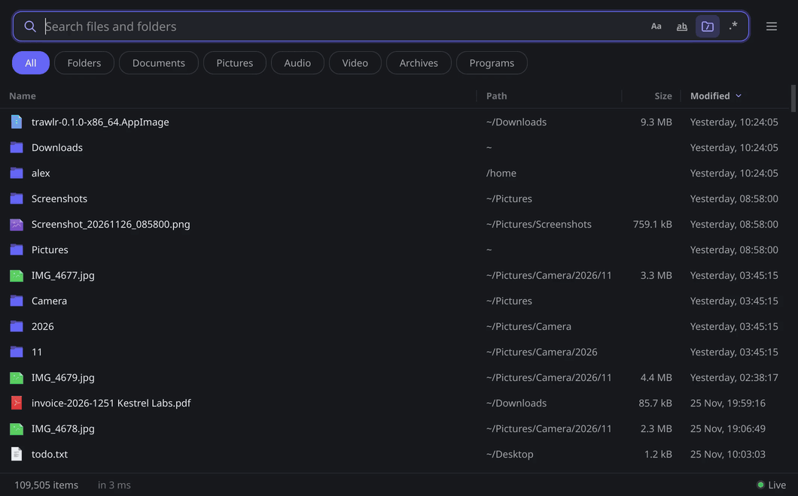
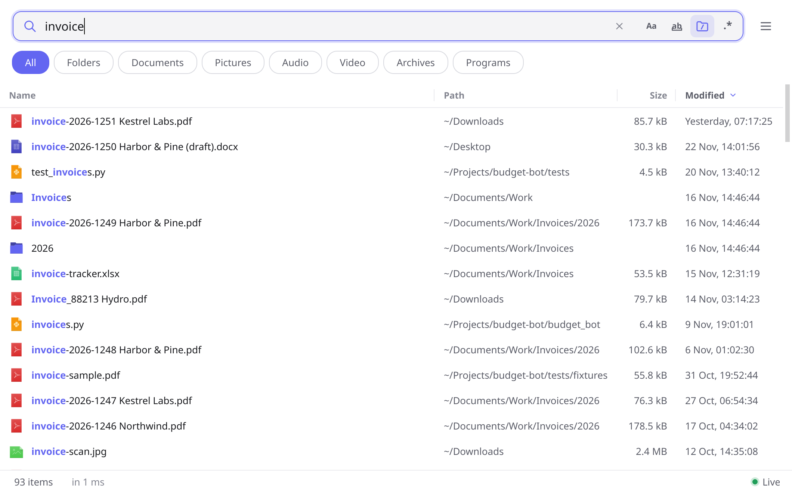

# Trawlr

Instant file-name search for Linux, Windows and macOS with an index that is always current, in the
spirit of [voidtools' Everything](https://www.voidtools.com/).

Type a few letters and every matching file and folder on the machine is listed before you finish the
word. Files appear in the results the moment they are created, and vanish when they are deleted, with
no rescanning and no "update database" step, however long the program has been closed.

Not affiliated with voidtools.

**[trawlr.io](https://trawlr.io)** · **[Download](../../releases/latest)** · [Install](#install) · [Search syntax](#search-syntax)

<p align="center"></p>

## How it works

voidtools' Everything is fast on Windows because it never walks the disk: it reads the NTFS change journal and
keeps an index in memory. Trawlr does the same on Windows, and the same with what Linux and macOS
offer on those.

- **`trawlrd`** is a small system service. It holds every file and folder name in memory and
  watches each disk with a single filesystem-wide [fanotify](https://man7.org/linux/man-pages/man7/fanotify.7.html)
  mark, so the kernel reports every create, delete and rename no matter how many folders there are.
  (inotify, which most tools use, needs one watch per folder and runs out on a real home directory.)
- The index is saved at shutdown. At the next start it is loaded in a fraction of a second and
  checked against the disk in the background, so changes made while the service was not running
  are picked up too.
- **On Windows**, `trawlrd` is a Windows service. It reads each NTFS drive's master file table
  directly, which indexes a drive with a million files in about two seconds, and follows the
  drive's change journal. After a restart it carries on from where the journal left off, so
  nothing is rescanned.
- **On macOS**, `trawlrd` is a launchd daemon. It reads folders with `getattrlistbulk`, many
  entries per call, and follows [FSEvents](https://developer.apple.com/documentation/coreservices/file_system_events),
  which reports changes by path and keeps a history: after a restart the daemon asks for
  everything since the last event it applied, so here too nothing is rescanned.
- **The window** (`trawlr-gui`) and **the `trawlr` command** are thin clients. They hold no index
  of their own and open instantly. `trawlr` on its own opens the window; `trawlr` followed by a
  search prints the matches in the terminal.

## Install

### Windows

Download `trawlr-…-windows-x64-setup.exe` from the [Releases](../../releases) page and run it.
It installs the service (which starts indexing every local NTFS drive straight away), adds Trawlr
to the Start menu and, if you leave the boxes ticked, starts Trawlr in the tray when you sign in
and puts the `trawlr` command on PATH. Needs Windows 10 or 11 (x64) and an administrator to
install. Administrators can search; see [Who can search](#who-can-search) to let others in.

Global hotkeys are under **Tools → Options → Keyboard**; they work while Trawlr runs, from any
program, including from the tray with no window open.

### macOS

With [Homebrew](https://brew.sh):

```sh
brew install --cask samuelcgilbert/trawlr/trawlr
```

Or download `trawlr-…-macos.pkg` from the [Releases](../../releases) page. It runs on Apple Silicon
and Intel Macs with macOS 12 or newer.

The package is not signed with an Apple Developer ID (that costs money, and Trawlr is free), so
macOS will not open a downloaded package with a double-click the first time. Either right-click it and choose
**Open**, or, on macOS 15 and later, double-click it, then go to **System Settings → Privacy &
Security** and click **Open Anyway** next to the message about it.

The installer puts Trawlr in Applications, starts the indexing daemon (which indexes the whole Mac,
including disks under `/Volumes`) and adds the `trawlr` command to `/usr/local/bin`. Administrators
can search; see [Who can search](#who-can-search) to let others in.

One more step: macOS keeps Desktop, Documents, Downloads, Mail and a few other folders private from
every program that has not been given **Full Disk Access**, root daemons included, so until then
Trawlr cannot list them (the window says so). In **System Settings → Privacy & Security → Full Disk
Access**, click **+**, press **⇧⌘G**, enter `/Applications/Trawlr.app/Contents/MacOS/trawlrd`,
click **Open** and make sure it is switched on. The folders appear in the results within a minute.
Because the program is not signed with a Developer ID, macOS forgets this permission when Trawlr is
updated; turn it off and on again (or remove and add it) after an update.

Global hotkeys are under **Settings (⌘,) → Keyboard**. They work while Trawlr runs, including from
its menu-bar icon with no window open, and *Start Trawlr when I sign in* is under General.

To remove everything: `sudo "/Applications/Trawlr.app/Contents/Resources/uninstall.sh"`.

### Linux

Needs Linux 5.9 or newer and systemd. Packages for each release are on the
[Releases](../../releases) page:

| Distribution | Package | Install with |
| --- | --- | --- |
| Ubuntu 22.04, 24.04, Debian 12, 13 (and derivatives such as Mint, Pop!_OS, KDE neon) | `trawlr_….ubuntu24.04_amd64.deb` (pick your release) | `sudo apt install ./trawlr_….deb` |
| Fedora | `trawlr-….fc45.x86_64.rpm` | `sudo dnf install ./trawlr-….rpm` |
| openSUSE Tumbleweed | `trawlr-….tumbleweed.x86_64.rpm` | `sudo zypper install ./trawlr-….rpm` |
| Arch, Manjaro, EndeavourOS | `trawlr-…-x86_64.pkg.tar.zst` | `sudo pacman -U ./trawlr-….pkg.tar.zst` |

There are `arm64`/`aarch64` builds as well. The packages start the service straight away (on Arch:
`sudo systemctl enable --now trawlrd`). Members of the administrator group (`sudo` or `wheel`)
can search; see [Who can search](#who-can-search) to let others in.

### From source

Needs a Rust toolchain (1.85 or newer) and Qt 6.2 or newer for the window.

```sh
# Debian / Ubuntu / KDE neon
sudo apt install cargo build-essential qt6-base-dev
# Fedora:  sudo dnf install cargo gcc-c++ make qt6-qtbase-devel
# Arch:    sudo pacman -S rust base-devel qt6-base

./install.sh
```

Debian 12 and Ubuntu 24.04 or older package a Rust that is too old; `install.sh` says so and
points to [rustup.rs](https://rustup.rs), which installs a current one without root.

`install.sh` builds as you, then asks for your sudo password once to install to `/usr/local`, write
`/etc/trawlrd/config.toml` and start the service. The first scan takes from a few seconds to a
few minutes depending on the disk; you can search while it runs.

Afterwards open **Trawlr** from the application menu. To get a search window on a hotkey, set one under **Tools → Options → Keyboard → Global hotkeys** (KDE
Plasma), or bind a key to the command `trawlr` in your desktop's keyboard settings.

`./install.sh --no-gui` installs only the service and `trawlr`. `./uninstall.sh` removes it again
(`--purge` also deletes the configuration and the saved index).

## Using it

<picture>
  <source media="(prefers-color-scheme: dark)" srcset="docs/screenshot-dark.png">
  
</picture>

| Key | Action |
| --- | --- |
| type | search as you type |
| `↓` / `↑` | move into and through the results |
| `Enter` | open with the default application |
| `Ctrl+N` | new window |
| `Ctrl+,` | options |
| `Ctrl+Enter` | open the containing folder with the item selected |
| `Shift+Enter` | open, then put the window away (to the tray, or minimized) |
| `Ctrl+T` | open a terminal in the item's folder |
| `Ctrl+Shift+T` | run the file in a terminal, which stays open afterwards so you can read the output |
| `Ctrl+C` | copy the files (paste them into a file manager) |
| `Ctrl+Shift+C` | copy the full path |
| `Alt+Enter` | properties |
| `Delete` | move to the trash (asks first) |
| `Ctrl+I` `Ctrl+B` `Ctrl+U` `Ctrl+R` | match case, whole word, path, regex |
| `Esc` | clear the search; close the window if it is already empty |

Double-click a result to open it, or double-click its path to open the folder it is in (this can be
changed under **Options → General**). Shift+double-click opens it and puts the window away. Click a
column header to sort; drag results out of the window into other applications. `Ctrl+M` shows the
menu bar; everything in it is also in the ☰ menu.

*Match path* is on unless you turn it off (`Ctrl+U`): each word may match anywhere in the full path,
so `photos 2024` finds files in a folder named Photos with 2024 in their name.

To hide a folder you are not interested in, right-click any result in it and choose **Exclude from
Results**, then the folder (the menu lists every folder the result is in). The folder and everything
in it is left out of every search, and the status bar says how many folders are excluded. They are
listed under **Options → Search**, where you can remove them or add more. This only changes your
results; to stop indexing a folder for everyone, use `exclude` in the configuration (below).

### One window or many

Starting Trawlr while a window is already open (from the hotkey, the launcher or a terminal)
brings that window to the front with its search selected, so you can type straight over it.
`trawlr --gui some words` puts those words in the search box of the window that comes forward.
Under **Tools → Options → General**, *Allow multiple windows* makes every start open another window
instead, and `trawlr --new-window` does that once, whatever the setting. **File → New Window**
(`Ctrl+N`) does the same from inside.

On KDE Plasma the window is brought forward by asking KWin to activate it, because Wayland does not
let a program that is not in the foreground raise itself. Other desktops get a plain raise request,
which they may only show as a flashing taskbar entry.

### Options

**Tools → Options** (`Ctrl+,`) has pages on the left (General, View,
Search, Terminal, Keyboard), and OK, Cancel, Apply and Restore Defaults (for the page you are on) at the
bottom. Nothing changes until OK or Apply. Press `/` anywhere in the window to jump to the search
box above the pages: it hides pages with nothing that matches, highlights the matching settings,
and on the Keyboard page narrows the command list to matching commands. `Enter` goes to the first
match, `Esc` clears the search.

- **General**: allow multiple windows, system tray icon, what double-clicking a path does.
- **View**: theme (System, Light, Dark), accent colour, row density, menu bar.
- **Search**: match case, whole word, path and regex for every open window, whether a window
  brought to the front keeps its last search or starts empty, and the excluded folders.
- **Terminal**: which terminal Open/Run in Terminal use. *Automatic* picks your desktop's own
  (Konsole, GNOME Console, Ptyxis, …); any installed terminal or a custom command can be chosen.
- **Keyboard**: global hotkeys and the shortcuts in the window.

### Changing the keys

**Tools → Options → Keyboard** lists every command in the window with its shortcuts. Pick one and
use **Add…**, **Edit…** or **Remove**; a command can have several keys. The Add box says which
command has the key now; that command loses it. **Default** puts back one command's key, and
Restore Defaults all of them. `Enter`, `Esc` and the arrow keys have fixed meanings and are not
listed.

The same page holds three **global hotkeys**: *Show window* (`trawlr`),
*New window* (`trawlr --new-window`) and *Toggle window* (`trawlr --toggle`, which
hides the window if it is the active one and brings it forward otherwise). A hidden window is off
the screen, the taskbar and Alt+Tab, but Trawlr keeps running with an icon in the system tray:
click it to show or hide the window, or right-click it for New Window, Options and Exit. The icon
can be turned off under **General**. The desktop owns
these keys, so they work with no window open and show up in System Settings → Shortcuts as well.
Only KDE Plasma lets a program set them; on other desktops the boxes are disabled and you bind
keys to those commands yourself.

On the command line (`trawlr --help` lists every option):

```sh
trawlr invoice pdf                    # names containing both words
trawlr -l -s date -d dm:today         # what changed today, newest first, with size and time
trawlr -n 20 -s size -d 'size:>1gb'   # the 20 largest files (quote < and > for the shell)
trawlr --count ext:jpg                # how many
trawlr -0 ext:flac | xargs -0 du -ch | tail -1   # NUL-separated, for scripting
trawlr --status                       # what is indexed and how it is watched
```

## Search syntax

Most of the time plain text is enough: `tax 2025` finds names with both words, and `.flac` finds FLAC files. The syntax below is for when it isn't; it follows that of voidtools' Everything, so it will be familiar to its users.

| Search | Finds |
| --- | --- |
| `foo bar` | names containing both `foo` and `bar` |
| `foo\|bar` | either |
| `!foo` | not `foo` |
| `"foo bar"` | the phrase, space included |
| `<a\|b> c` | grouping |
| `*.pdf`, `inv?ice*` | wildcards; they must match the whole name |
| `docs/ report` | a term containing `/` is matched against the full path |
| `ext:jpg;png` | by extension |
| `size:>10mb`, `size:1mb..2gb`, `size:empty` | by size (`tiny` `small` `medium` `large` `huge` `gigantic`) |
| `dm:today`, `dm:2024-03`, `dm:last2weeks`, `dm:>2023` | by date modified (`yesterday` `thisweek` `lastmonth` `a..b`) |
| `file:` `folder:` | only files, only folders |
| `audio:` `video:` `pic:` `doc:` `zip:` `exe:` | by kind |
| `parent:/some/folder` | directly inside that folder |
| `empty:` | empty folders |
| `case:` `path:` `regex:` `ww:` `wfn:` `startwith:` `endwith:` | per-term: match case, match the path, regular expression, whole word, whole name, prefix, suffix |

Matching is case-insensitive unless asked otherwise. Results are sorted by name by default.

## Configuration

`/etc/trawlrd/config.toml` on Linux (see [`dist/config.toml`](dist/config.toml) for every option),
`C:\ProgramData\Trawlr\config.toml` on Windows (see [`dist/windows/config.toml`](dist/windows/config.toml)),
`/Library/Application Support/Trawlr/config.toml` on macOS (see [`dist/macos/config.toml`](dist/macos/config.toml)):

```toml
roots = ["/"]                                   # what to index
exclude = ["/var/lib/docker"]                   # folders to leave out
exclude_names = ["node_modules"]                # names to leave out everywhere
allowed_users = ["sam"]                         # who may search
allowed_groups = ["sudo", "wheel", "trawlr"]    # ... and members of these groups
```

Apply changes with `sudo systemctl restart trawlrd`, or on Windows, in an administrator Command
Prompt, `sc stop trawlrd && sc start trawlrd`. On Windows `roots` names whole drives (`["C:", "D:"]`,
default: every local NTFS drive) and paths are written with `\`. On macOS:
`sudo launchctl kickstart -k system/io.trawlr.trawlrd`.

Local disk filesystems are indexed across mount points automatically, and drives are added and
removed as they are mounted and unmounted. Virtual filesystems (`/proc`, tmpfs, overlay, snap
images) and network mounts are skipped unless listed in `extra_fs_types` or named as a root.
Timeshift and Snapper snapshot folders are left out, because they contain another copy of every
file name on the system (set `index_snapshots = true` to include them).

## Who can search

The service runs as root, since only root may watch a whole filesystem, and it therefore knows the
name of every file on the machine, including files in other users' homes. Names only: it never
reads file contents.

- Only root, users listed in `allowed_users` and members of the groups in `allowed_groups` can
  query it. By default those groups are the administrator groups (`sudo`, `wheel`, `admin`), whose
  members can read every file anyway, and `trawlr`, which the installer creates for everyone else:
  `sudo usermod -aG trawlr NAME`. The installer also adds the user who ran it to `allowed_users`.
  Anyone allowed in can see names in folders they could not otherwise list, so on a shared machine
  treat it like membership of an admin group.
- On Windows the service runs as the system account, which reading a drive's file table needs.
  Administrators (elevated or not) and members of a local `trawlr` group can search:
  `net localgroup trawlr /add`, then `net localgroup trawlr NAME /add`. The service keeps its
  index in `C:\ProgramData\Trawlr`, which it makes readable by administrators only, answers only
  on the local machine, and drops every privilege it does not need.
- On macOS the daemon runs as root. Members of the `admin` group (every administrator account)
  can search; add `"staff"` to `allowed_groups` to let every user in. Its index is in
  `/Library/Application Support/Trawlr`, readable by root only.
- On Linux the service is confined by systemd to exactly what it needs: two capabilities
  (`CAP_SYS_ADMIN` for fanotify, `CAP_DAC_READ_SEARCH` to list folders), no network, and a read-only
  view of the system apart from its own state directory. See [`dist/trawlrd.service`](dist/trawlrd.service).

## Without root

`./install.sh --user` installs a per-user service instead. It indexes only your home folder and
needs no privileges, but the kernel then only allows one watch per folder, capped by
`fs.fanotify.max_user_marks` (typically a few hundred thousand, shared by all your programs) and
costing kernel memory for each. It suits a modest home directory. `trawlr --status` reports if folders
had to be left unwatched.

## What to expect

Measured on a Ryzen 5 7640U laptop with an NVMe SSD and 2.8 million files and folders indexed:

| | |
| --- | --- |
| First scan | 1.5 s with a warm cache, 8 s cold |
| Start with a saved index | 0.3 s to load, 0.5 s to check 268,000 folders against the disk |
| Typical search | 1 to 15 ms |
| Listing all 2.8 million entries, sorted by name | 9 ms |
| Sorting all of them by size or date | 55 to 90 ms |
| Memory | about 190 MB, roughly 70 bytes per entry |
| A new file showing up in an open window | under 0.2 s (the service knows within 15 ms) |

Things to know:

- **Size and date update when a file is closed**, not while it is still being written. A download
  shows its final size when it finishes.
- **Changes made while the service is not running** (another operating system, a rescue disk) are
  found at the next start if they added, removed or renamed something. A file that was only
  rewritten in place keeps its old size and date in the index until it changes again or you run
  `trawlr --rescan`. After a crash or power loss everything is re-read automatically.
- **Tested on ext4, btrfs and FAT**, all with filesystem-wide watching, on Linux 7.0. XFS, F2FS, ZFS,
  bcachefs and NTFS are indexed too but have not been tried; if a filesystem does not accept a
  filesystem-wide mark the service falls back to watching it folder by folder and says so in its
  log. A btrfs volume with several subvolumes mounted separately is untested.
- **Network and FUSE filesystems** can be indexed by naming them as roots, but changes made from
  other machines are not reported by the kernel, so they are only as fresh as the last rescan.
- The window opens, copies, trashes and shows properties. It does not rename files or search
  inside them.
- The index is limited to 4 GB of name text, which is in the region of 150 million files.

## Troubleshooting

```sh
systemctl status trawlrd      # is it running?
journalctl -u trawlrd -e      # what it has been doing
trawlr --status                # what it indexes and how each filesystem is watched
trawlr --rescan                # compare the whole index with the disk now
trawlr --rebuild               # throw the index away and start over
```

On Windows: `sc query trawlrd` (is it running?), the log in `C:\ProgramData\Trawlr\trawlrd.log`
(as administrator), and the same `trawlr --status`, `--rescan`, `--rebuild`.

On macOS: `sudo launchctl print system/io.trawlr.trawlrd` (is it running?), the log in
`/Library/Logs/Trawlr/trawlrd.log` (`sudo cat` it), and the same `trawlr` commands. `trawlr --status`
lists folders it could not read; most often that means Full Disk Access (see [Install](#macos)).

"this user is not allowed to search the system index": add the user to the `trawlr` group
(`sudo usermod -aG trawlr NAME`, no restart needed), or to `allowed_users` in
`/etc/trawlrd/config.toml` and restart the service.

## Development

```sh
cargo test --release           # index, query language and sorting
python3 tests/stress.py        # random creates, renames, moves and deletes against a live daemon,
                               # comparing the index with the disk after every round
tests/vm/run.sh                # the same and more as root inside a throwaway QEMU VM: filesystem-wide
                               # watches on ext4/btrfs/FAT, hot-plugged drives, the systemd confinement

# the window itself, driven off screen against a real daemon
(mkdir -p gui/tests/build && cd gui/tests/build && qmake6 ../tests.pro && make && QT_QPA_PLATFORM=offscreen ./tst_gui)

tests/distros/run.sh           # in docker: build, install, test and package on Ubuntu, Debian,
                               # Fedora, openSUSE and Arch
tests/demo/run.sh              # in docker: retake the pictures in docs/ from a made-up home folder
```

On Windows, with Rust, the Visual Studio build tools, Qt 6 for MSVC and Inno Setup 6 installed,
from a developer prompt:

```bat
cargo test --release
powershell -File dist\windows\build.ps1       &:: the programs and the installer, in dist\out
powershell -File tests\windows\run.ps1        &:: as administrator: index C: and check live updates
```

On macOS, with Rust and Qt 6 for macOS (`qmake` on PATH):

```sh
cargo test --release
dist/macos/build.sh            # Trawlr.app and the installer package (universal), in dist/out
tests/macos/run.sh             # with sudo: index the whole Mac and check live updates and restarts
```

Releases: push a tag such as `v0.1.0` and [`release.yml`](.github/workflows/release.yml) builds
the packages ([`dist/package.sh`](dist/package.sh), [`dist/arch/PKGBUILD`](dist/arch/PKGBUILD))
for x86_64 and arm64, the Windows installer ([`dist/windows`](dist/windows)) and the macOS
package ([`dist/macos`](dist/macos)), and attaches them to a draft release. Once it is
published, [`dist/listings.sh`](dist/listings.sh) `0.1.0` fills in the Homebrew cask (for the
[tap](https://github.com/SamuelCGilbert/homebrew-trawlr)), the winget manifests and the AUR files
from it, in `dist/out/listings`.

The layout: [`src/index.rs`](src/index.rs) is the in-memory index, [`src/query.rs`](src/query.rs)
the search language and matcher, [`src/scan.rs`](src/scan.rs) reads directories,
[`src/watch.rs`](src/watch.rs) wraps fanotify, [`src/indexer.rs`](src/indexer.rs) is the single
writer that ties them together, [`src/server.rs`](src/server.rs) the socket protocol, and
[`gui/`](gui) the Qt client. On Windows, [`src/win/`](src/win) replaces the Linux disk reading and
watching: [`ntfs.rs`](src/win/ntfs.rs) reads the MFT, [`usn.rs`](src/win/usn.rs) the change
journal, [`indexer.rs`](src/win/indexer.rs) applies them, and [`pipe.rs`](src/win/pipe.rs) and
[`service.rs`](src/win/service.rs) are the named pipe and the service. On macOS,
[`src/mac/`](src/mac) does the same with [`scan.rs`](src/mac/scan.rs) (`getattrlistbulk`),
[`fsevents.rs`](src/mac/fsevents.rs), [`indexer.rs`](src/mac/indexer.rs) and
[`service.rs`](src/mac/service.rs) (launchd).

## License

Copyright © 2026 Sam Gilbert. Trawlr is free software: you can redistribute it and/or
modify it under the terms of the GNU General Public License as published by the Free
Software Foundation, either version 3 of the License, or (at your option) any later
version. See [`LICENSE`](LICENSE).

Created in [T3 Code](https://t3.codes).
